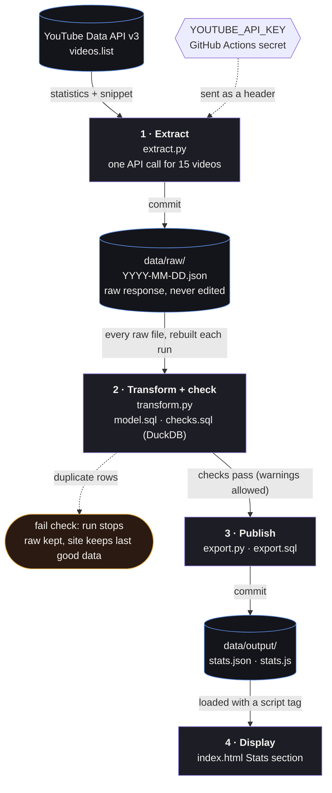
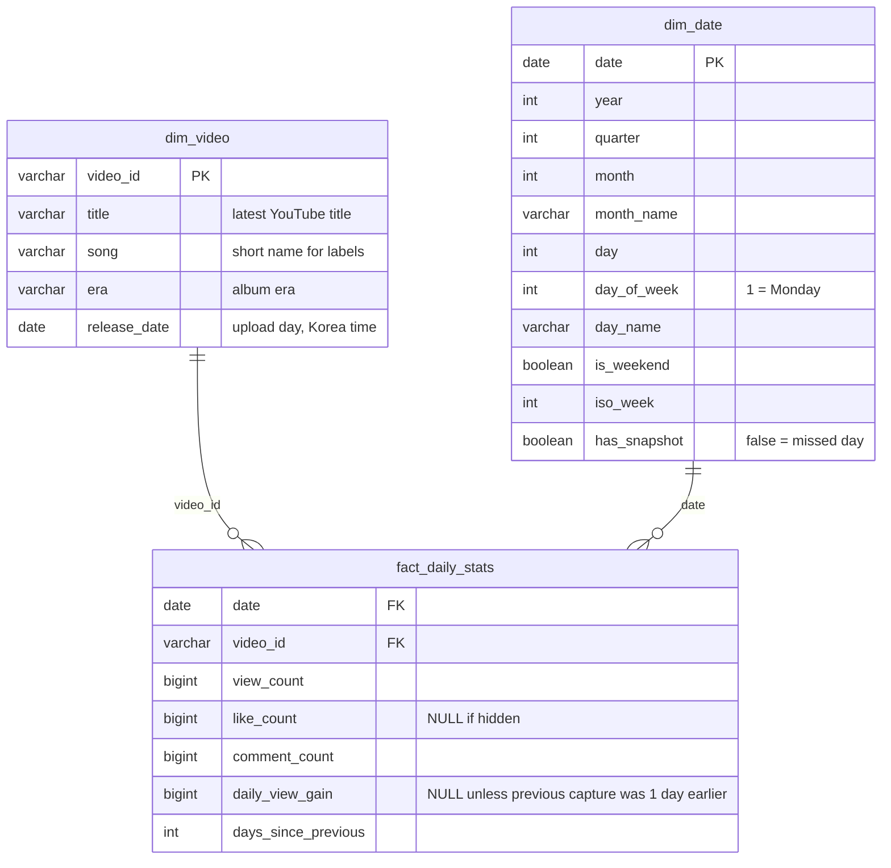

# NewJeans MV stats

A small daily data pipeline that tracks YouTube views, likes and comments for
15 official NewJeans music videos, keeps the full history, models it as a star
schema, and shows the trends on my NewJeans fan site.

The pipeline is the main piece of work. The website only **displays** the data
the pipeline publishes.

- **Extract:** Python calls the YouTube Data API v3 once a day and saves the
  response untouched.
- **Schedule:** GitHub Actions runs everything at 08:17 Singapore time.
- **Transform:** DuckDB SQL builds `dim_video`, `dim_date` and
  `fact_daily_stats` from every raw file, then runs data quality checks.
- **Publish:** a small `stats.json` (plus `stats.js`) is committed for the site.
- **Display:** the Stats section of `index.html` draws the chart and tables.

## Architecture



Steps 1–3 run in GitHub Actions every day at 00:17 UTC (08:17 Singapore). Each
step commits before the next one starts, so a failure later in the run never
loses data captured earlier.

## Repo layout

```
.github/workflows/daily.yml   the schedule: extract → commit raw → transform → export → commit
pipeline/
  videos.csv                  the 15 tracked videos: video_id, song, era
  extract.py                  Extract: API call → data/raw/YYYY-MM-DD.json
  model.sql                   Transform: staging view + star schema
  checks.sql                  data quality checks (one query per check)
  transform.py                builds the model and runs the checks
  export.sql                  one query per key of stats.json
  export.py                   Publish: writes data/output/stats.json and stats.js
  requirements.txt
  tests/                      23 tests, no API key or network needed
data/
  raw/                        one file per day, exactly as YouTube sent it
  output/                     what the site reads
index.html                    the fan site (Stats section at the bottom)
```

## Data model

The whole model is **rebuilt from `data/raw/` on every run**. Raw files are the
source of truth, so a rebuild always gives the same answer, and fixing a bug in
the SQL fixes all of history at once.



| Table | Grain | Notes |
|---|---|---|
| `stg_video_stats` (view) | one row per video per raw file | Fields are read out of the JSON one by one, so a missing field (e.g. hidden likes) becomes `NULL` instead of breaking the read. |
| `dim_video` | one row per video in `videos.csv` | Kept even if YouTube never returns the video. `release_date` is the upload time converted to Korean time (YouTube reports UTC, which would put every release a day early). |
| `dim_date` | one row per calendar day, first capture to latest | Includes days with no raw file; `has_snapshot = false` is the missing-day flag. |
| `fact_daily_stats` | one row per video per captured day | `daily_view_gain` is only filled when the previous capture was exactly one day earlier, so a two-day gain never shows up as a fake one-day spike. |

## Data quality checks

Defined in `pipeline/checks.sql`. Each check is a query that returns the rows
breaking the rule. No rows means the check passed.

| Check | Severity | Rule | Why this severity |
|---|---|---|---|
| `duplicate_video_date` | **fail** | at most one row per video per day | A duplicate would double-count. The run stops, nothing is exported, and the site keeps the last good data. |
| `negative_daily_gain` | warn | views shouldn't go down | They legitimately can: YouTube removes fake views. Failing would break the run on a real upstream event. |
| `missing_day` | warn | a raw file exists for every day in range | A missed run is worth knowing about but doesn't make the other days wrong. |
| `video_missing_from_snapshot` | warn | every tracked video appears in every capture | Missing means deleted, made private, or a wrong ID. |

Warnings are written into `stats.json` and shown above the chart on the site,
so they're visible without opening the Actions logs.

## Running it locally

You need Python 3.10+ and a YouTube Data API v3 key (Google Cloud Console →
APIs & Services → Credentials; restrict it to "YouTube Data API v3").

```bash
git clone https://github.com/horizon153/NewJeans-stats
cd NewJeans-stats
pip install -r pipeline/requirements.txt

# Extract (skips without calling the API if today's file already exists)
export YOUTUBE_API_KEY="your-key"        # Windows PowerShell: $env:YOUTUBE_API_KEY="your-key"
python pipeline/extract.py

# Transform + checks (add --db stats.duckdb to keep a database you can query)
python pipeline/transform.py

# Publish
python pipeline/export.py

# Tests (no key or network needed)
pip install pytest
python -m pytest pipeline/tests -q
```

To see the site, open `index.html` in a browser straight from the folder. To
get the latest data, pull the repo first (`git pull`, or Fetch in GitHub Desktop).

Never put the key in a file in this repo. In GitHub it lives only in
**Settings → Secrets and variables → Actions** as `YOUTUBE_API_KEY`.

## The daily run

`.github/workflows/daily.yml` runs at **00:17 UTC (08:17 Singapore)** and can
also be started by hand (Actions → Daily YouTube stats → Run workflow).

1. **Extract:** one `videos.list` call (`part=statistics,snippet`) for all 15 IDs,
   which costs 1 unit of the 10,000-unit daily quota.
2. **Commit raw file.**
3. **Transform and check:** stops the run on a `fail` check.
4. **Export** `stats.json` and `stats.js`.
5. **Commit site data:** only if something changed.

Running it twice in a day is safe. The second run finds today's raw file, skips
the API call, and the export comes out byte-identical, so nothing is committed.

## Design decisions

- **The key goes in a request header, not the URL.** Google's docs recommend
  the `x-goog-api-key` header; a key in the URL can end up in error messages and
  logs. GitHub also masks the secret as `***` in run logs.
- **Raw files are never edited.** `extract.py` refuses to overwrite and writes
  atomically, so a crash can't leave a half-written file.
- **No timestamp in `stats.json`.** The file only changes when the data does,
  which keeps the commit history meaningful.
- **`stats.js` as well as `stats.json`.** Browsers block `fetch()` on pages
  opened straight from disk, but a `<script src>` tag works, and the site is
  opened locally.
- **The chart shows views gained since tracking began by default.** A few
  hundred thousand new views barely move a line on a 300-million scale, so total
  views look flat. "Total views" is one click away.
- **All 15 MVs in gray with one highlighted in its era color.** Fifteen
  distinct colors can't be told apart; one highlighted line can.

## Adding or removing a video

Edit `pipeline/videos.csv` (`video_id,song,era`). Use one of the five era names
the site knows (New Jeans, OMG, Get Up, How Sweet, Supernatural) so the video
gets its era color. A new video's history starts the day it's added; earlier raw
files simply don't contain it, and the `video_missing_from_snapshot` check will
list those earlier days. That's expected.

## Limitations

- GitHub can start scheduled runs late when it's busy, so a "daily" gain covers
  roughly, not exactly, 24 hours.
- YouTube's public counts update with a delay and are sometimes corrected
  downwards (see `negative_daily_gain`).
- With fewer than two days of data there are no gains yet, and the site says so.
